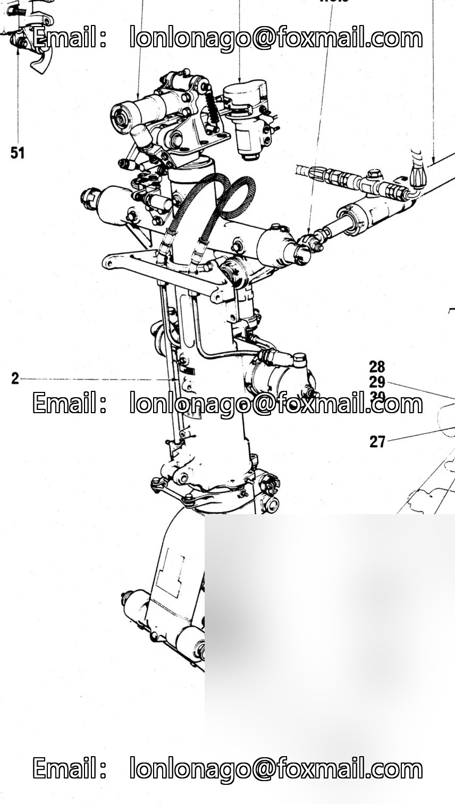
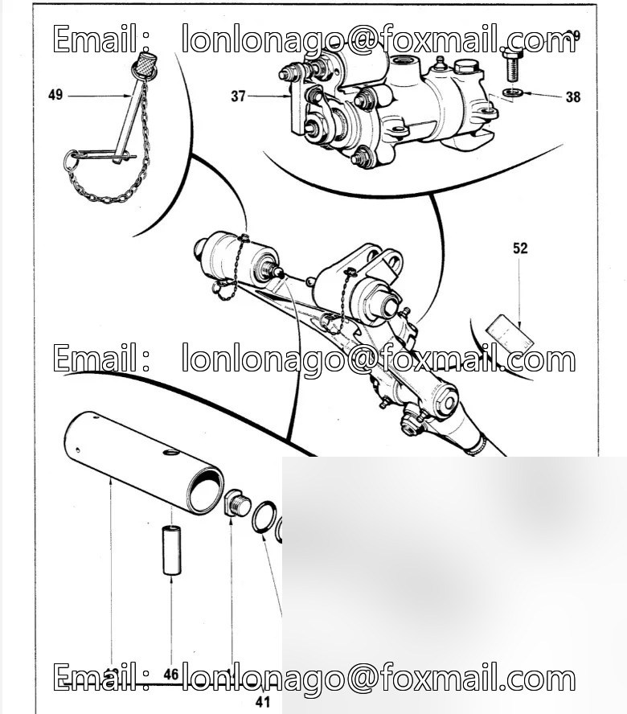
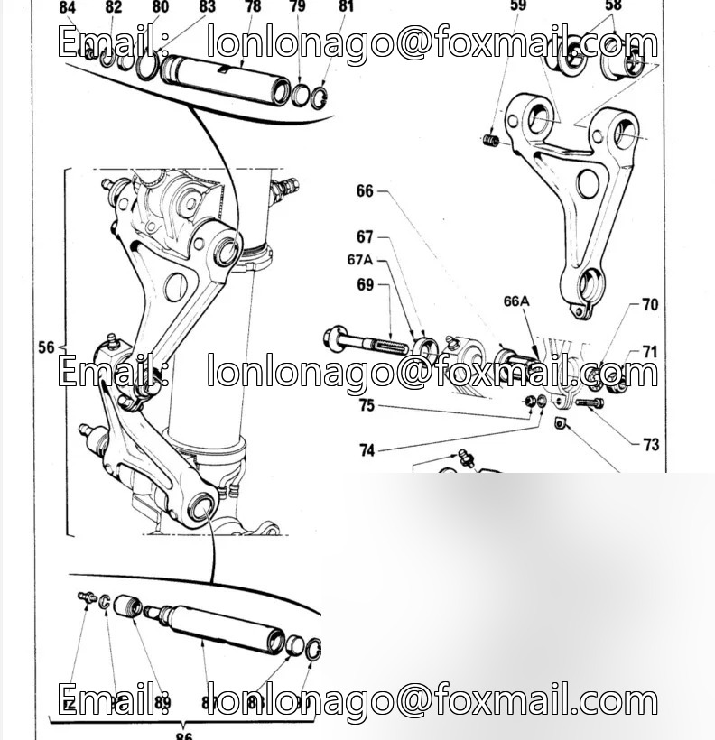

# Embraer IPB landing gear technical documentation

## Body

Embraer IPB landing gear technical documents: Embraer (Brazilian aviation industry company) IPB PDF file, 100 pages, applicable to Embraer E-Jet series (ERJ-170/175/190/195 family, commercial code E170/E175/E190/E195).
66962
1. Landing gear hydraulic actuation system (IPB) principle and structure
2. System design, maintenance, and fault troubleshooting
3. Technical parameters, interface specifications
4. Engineering application cases

2. Technical background
The Embraer E-Jet series is a commercial jet airliner, its I-PB landing gear system is one of its core flight safety systems, this material deeply analyzes the system architecture and working principles, suitable for research and reference on aviation engineering, maintenance training, and technical analysis.

3. Delivery methods
refunds upon sale

The document covers Embraer IPB landing gear technical principles, structure, design maintenance, parameters, interface specs and engineering applications, in PDF form with 100 pages, applicable to Embraer E-Jet series (ERJ-170/175/190/195 family).

<!-- AI_ENRICHED -->

## Images

## Payment

Here is a pay link on Stripe ( https://buy.stripe.com/3cs8yP7sY87d0vu9AB ). Please contact me lonlonago@foxmail.com after funding $89, and I will send you a complete data files , thank you!

